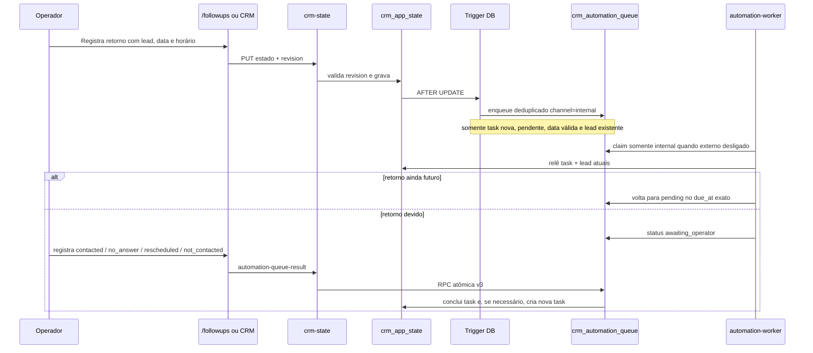
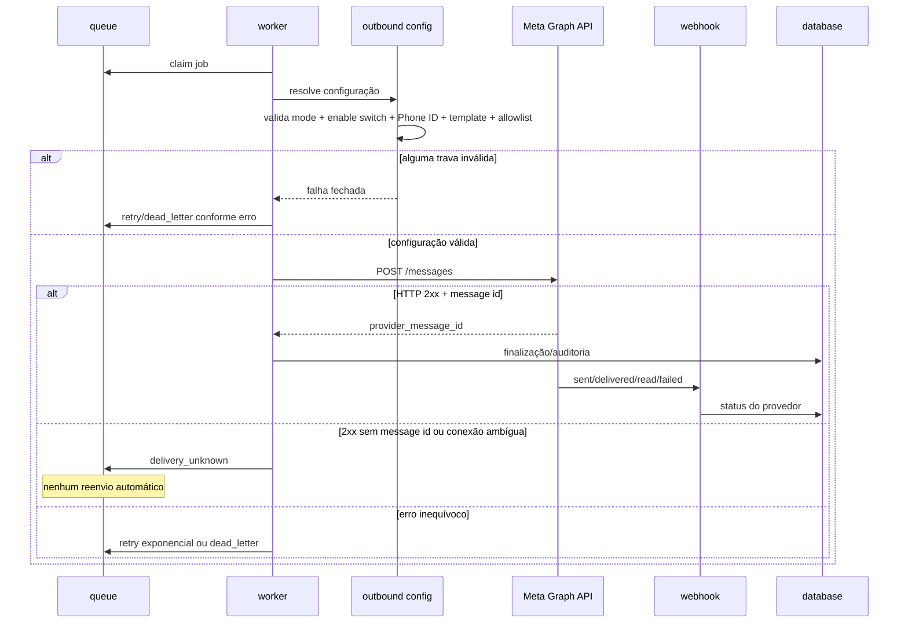

# Arquitetura — CRM Instituto Pâmela Pastore

Atualizado em 16/10/2026.

## Objetivo

Este documento descreve a arquitetura atualmente publicada do CRM e das automações. O desenho prioriza quatro propriedades: isolamento do banco, processamento idempotente, separação entre automação interna e canais externos e modo `fail-closed` para WhatsApp.

## Visão geral

```mermaid
flowchart LR
  U[Secretaria / Operador] -->|HTTPS + sessão| UI[CRM principal /]
  U --> FU[/followups]
  U --> AT[/atendimentos]

  UI --> API[Netlify Function crm-state]
  FU --> API
  AT --> API

  API -->|service role validado| DB[(Supabase CRM exclusivo\ndxfzuxybubvnjertiowf)]
  DB --> STATE[crm_app_state]
  DB --> Q[crm_automation_queue]
  DB --> ATT[crm_automation_attempts]
  DB --> EXP[crm_customer_experience]
  DB --> MSG[crm_whatsapp_messages]

  STATE -->|trigger transacional| Q
  Q --> W[Netlify scheduled function\nautomation-worker */5 min]
  W -->|INTERNAL_AUTOMATIONS_ENABLED| INT[Follow-up / recuperação manual]
  W -.->|somente com gates externos habilitados| META[Meta WhatsApp Cloud API]
  META --> WH[whatsapp-status-webhook]
  WH --> MSG
  WH --> ATT
  WH --> EXP
  EXP -->|review_pending| Q
  Q -.->|template neutro, somente após ativação| META

  OLD[(Supabase legado\npposribyzhxyupbxrpfo)]:::blocked
  API -. bloqueado por código .-> OLD
  W -. bloqueado por código .-> OLD
  WH -. bloqueado por código .-> OLD

  classDef blocked fill:#f8d7da,stroke:#842029,color:#842029;
```

O projeto `pposribyzhxyupbxrpfo` é legado da Agenda Pilates/CRM antigo. Os caminhos atuais do CRM validam a URL e a credencial do Supabase e rejeitam qualquer projeto diferente de `dxfzuxybubvnjertiowf` antes da chamada de dados.

## Fronteiras de confiança

### Navegador

O navegador nunca recebe `SUPABASE_SERVICE_ROLE_KEY`, token da Meta, App Secret ou token de verificação de webhook. A interface conversa apenas com a Function `crm-state`, usando sessão HTTP-only assinada.

### Netlify Functions

As funções são a fronteira de servidor. Elas validam origem, sessão, configuração do banco e gates de automação. Qualquer integração externa deve ocorrer exclusivamente aqui.

### Supabase

As tabelas operacionais usam RLS e privilégios de menor acesso. `anon` e `authenticated` não possuem acesso direto às estruturas críticas. RPCs sensíveis são executáveis somente pelo `service_role`.

### Meta WhatsApp Cloud API

O canal externo permanece isolado pelo conjunto de gates. Um job interno não vira envio WhatsApp apenas por estar na fila.

## Estado e persistência

`crm_app_state` é a fonte de verdade do estado operacional da interface principal. O registro `id='main'` contém as coleções de negócio como leads, tarefas, vendas e atendimentos. O campo `revision` implementa controle otimista de concorrência.

Antes de um `PUT`, o backend relê a revisão atual. Gravações com revisão obsoleta recebem conflito. Existe ainda uma trava server-side que impede uma transição acidental de um CRM com registros para um estado comercial totalmente vazio.

## Fluxo de follow-up



Novos follow-ups da tela operacional exigem data e horário. O horário é interpretado em `CRM_BUSINESS_TIME_ZONE` (`America/Sao_Paulo`). Tarefas históricas que possuem somente data permanecem compatíveis e conservam o comportamento legado.

A deduplicação principal usa `crm:lead_follow_up_requested:task:<task_id>`. Alterar uma task existente não cria outro job. Uma task órfã, sem `leadId`, concluída ou com data inválida é ignorada pelo trigger de origem.

## Fluxo de atendimento e experiência

```mermaid
sequenceDiagram
  participant O as Operador
  participant A as /atendimentos
  participant API as crm-state
  participant E as customer-experience
  participant Q as queue
  participant W as worker
  participant M as Meta
  participant H as webhook

  O->>A: Registra atendimento
  A->>API: persiste status Agendado
  O->>A: Conclui atendimento
  alt sem autorização de acompanhamento
    A->>API: conclui atendimento sem automationEvent
  else autorização explícita + telefone válido
    A->>API: conclui + service_completed
    alt CUSTOMER_EXPERIENCE_ENABLED=false
      API-->>A: evento aceito como no-op; não cria pesquisa
    else feature habilitada
      API->>E: registra experiência idempotente
      E->>Q: satisfaction_request
      W->>M: template aprovado, somente com gates externos
      M-->>W: provider message id
      W->>E: finalização transacional
      M->>H: resposta/status assinado
      H->>E: classifica resposta suportada
      alt Excelente ou Boa
        E->>Q: review_invitation neutro
      else Poderia melhorar
        E->>Q: service_recovery_required internal
      end
    end
  end
```

A resposta visível `Excelente` é reconhecida também como fallback textual, mas o caminho preferido usa o payload estável `experience_very_good`. `Boa` usa `experience_good`; `Poderia melhorar` usa `experience_needs_improvement`.

Texto livre não é classificado automaticamente como satisfação. A mensagem pode ser persistida, mas não dispara a decisão de reputação sem resposta suportada.

## Fluxo de envio e confirmação WhatsApp



## Gates atuais de produção

O desenho só permite envio externo quando várias condições independentes são verdadeiras. O estado seguro esperado até homologação é:

- `INTERNAL_AUTOMATIONS_ENABLED=true`
- `AUTOMATIONS_ENABLED=false`
- `CUSTOMER_EXPERIENCE_ENABLED=false`
- `WHATSAPP_TEST_MODE=false`
- `WHATSAPP_OUTBOUND_MODE=disabled`
- `WHATSAPP_PRODUCTION_ENABLED=false`
- `WHATSAPP_PRODUCTION_PHONE_NUMBER_ID` ausente até onboarding seguro do número oficial.

## Número oficial

O número **+55 15 99673-4292** é operacional e está em uso diário. Arquitetura, testes e migrations não registram, migram nem substituem esse número. O Phone Number ID oficial só deve ser configurado depois de confirmar, em documentação Meta vigente, uma estratégia que preserve a operação existente.

## Modelo de falha

- Falha transitória conhecida: retry com backoff e limite de tentativas.
- Falha terminal conhecida: `dead_letter`.
- Resultado externo ambíguo: `delivery_unknown`, sem retry automático.
- Job interno aguardando humano: `awaiting_operator`.
- Task já concluída: job cancelado.
- Source inexistente ou inválido: dead letter/ignore conforme estágio.
- Concorrência de estado: HTTP 409 e recarga do estado.
- Banco incorreto: bloqueio antes da chamada.
